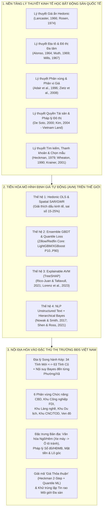

# 01. Khung Lý thuyết Kinh tế học Bất động sản, Tổng quan Mô hình Định giá Tự động (AVM/ML) trên Thế giới và Sự Thích ứng tại Thị trường Việt Nam

> **Tài liệu thuộc Dự án:** Ứng dụng Kinh tế lượng Không gian, Lý thuyết Hedonic và Học máy Giải thích được (XAI/AVM) trong Định giá Bất động sản Đa phân khúc đến Cấp Phường/Xã từ Dữ liệu Tin đăng Trực tuyến tại Việt Nam (*PropValue.AI*)  
> **Phiên bản:** 2.0  
> **Cập nhật lần cuối:** 02/11/2026  

---

## 1. Cơ sở Lý thuyết Kinh tế học Bất động sản Kinh điển & Hiện đại (Theoretical Foundations of Real Estate Economics)

Khác với thị trường chứng khoán hay hàng hóa tiêu dùng đồng nhất, **Bất động sản (Real Estate)** là một tài sản đặc biệt mang 4 tính chất kinh tế cốt lõi: **(1) Tính cố định tuyệt đối về vị trí không gian (*Spatial Immobility*)**, **(2) Tính dị biệt cao độ giữa từng tài sản (*Extreme Heterogeneity*)**, **(3) Tính bền vững lâu dài gắn liền với quyền tài sản pháp lý (*Durability & Institutional Property Rights*)**, và **(4) Chi phí giao dịch cùng bất cân xứng thông tin cao (*High Transaction Costs & Information Asymmetry*)**.

Để mô hình hóa và định giá chính xác bất động sản từ dữ liệu tin đăng trực tuyến, hệ thống **PropValue.AI** được xây dựng trên **5 trụ cột lý thuyết kinh tế học bất động sản kinh điển và hiện đại**:

### 1.1. Lý thuyết Tiêu dùng Thuộc tính của Lancaster (1966) & Cân bằng Thị trường Giá ẩn Hedonic của Rosen (1974)
- **Kelvin Lancaster (1966)** trong công trình *"A New Approach to Consumer Theory" (Journal of Political Economy)* và **Sherwin Rosen (1974)** trong bài báo nền tảng *"Hedonic Prices and Implicit Markets: Product Differentiation in Pure Competition" (Journal of Political Economy)* đã thiết lập nền móng cho mọi mô hình định giá bất động sản hiện đại:
  - Người mua nhà không trả tiền cho một "khối bê tông" trừu tượng, mà trả tiền cho một **vector gồm $K$ thuộc tính hữu ích** $\mathbf{Z} = (z_1, z_2, \dots, z_K)$ gắn liền với bất động sản đó.
  - Hàm giá thị trường cân bằng $P(\mathbf{Z})$ được hình thành tại tiếp điểm giữa đường đẳng ích giá thầu của người mua (*Buyer's Bid Function* $\theta(\mathbf{Z}; u, y)$) và đường đẳng lợi giá chào của người bán/chủ đầu tư (*Seller's Offer Function* $\phi(\mathbf{Z}; \pi)$).
  - Đạo hàm riêng $p_k(\mathbf{Z}) = \frac{\partial P(\mathbf{Z})}{\partial z_k}$ chính là **Giá ẩn biên (*Implicit Marginal Price / Shadow Price*)** của thuộc tính $k$ (ví dụ: thêm 1 mét rộng ngõ ô tô, có sổ đỏ chính chủ, hoặc nằm cách ga Metro dưới 500m làm tăng đơn giá mỗi $m^2$ thêm bao nhiêu triệu VNĐ).

### 1.2. Lý thuyết Đấu giá Địa tô Đô thị Đơn tâm & Đa tâm (*Monocentric & Polycentric Urban Bid-Rent Theory* — Alonso, 1964; Muth, 1969; Mills, 1967; McMillen, 2001)
- Mô hình **Alonso–Muth–Mills** chứng minh sự đánh đổi cơ bản trong không gian đô thị giữa **Chi phí đi lại/tiếp cận (*Commuting & Accessibility Cost*)** và **Giá đất tính trên mỗi đơn vị diện tích ($P/m^2$)**:
  $$\frac{\partial P(d)}{\partial d} < 0$$
  Khi khoảng cách $d$ từ tâm kinh tế (*Central Business District — CBD*) tăng lên, đơn giá đất giảm theo hàm mũ âm nhưng diện tích tiêu dùng bình quân tăng lên.
- Trong các siêu đô thị hiện đại (như TP. Hồ Chí Minh mở rộng và Hà Nội), cấu trúc đô thị đã chuyển sang **Đa tâm (*Polycentric Urban Structure* — McMillen, 2001; Anas, Arnott & Small, 1998)**: bên cạnh lõi lịch sử (Quận 1, Hoàn Kiếm), giá đất tạo thành các "đỉnh địa tô thứ cấp" (*Sub-centers*) xung quanh **Cụm đô thị mới (Cầu Giấy – Mỹ Đình, Thủ Thiêm – Phú Mỹ Hưng)**, **Đầu mối giao thông công cộng (Metro TOD)**, **Khu Công nghệ cao**, **Khu Công nghiệp FDI** và **Cụm Làng nghề truyền thống**.

### 1.3. Lý thuyết Phân vùng Thị trường Nhà ở & Bất đối xứng theo Phân vị (*Housing Submarket Segmentation & Quantile Hedonic Pricing* — Adair et al., 1996; Zietz et al., 2008; Liao & Wang, 2012)
- Thị trường bất động sản không phải là một thị trường thống nhất mà bị chia cắt thành các **Phân khúc (*Submarkets*)** theo loại hình và tầng giá trị.
- Nghiên cứu kinh điển của **Zietz, Zietz & Sirmans (2008, *Journal of Real Estate Finance and Economics*)** và **Liao & Wang (2012)** sử dụng Hồi quy Phân vị (*Quantile Regression*) đã chứng minh: **Cùng một thuộc tính (như diện tích, view sông, thang máy riêng, uy tín chủ đầu tư) được người mua ở phân khúc hạng sang ($P_{75}-P_{90}$) định giá cao gấp 2–4 lần so với người mua ở phân khúc bình dân ($P_{10}-P_{25}$)**. Do đó, việc xây dựng **Tháp Phân tầng Giá trị 6 Tầng (`T1..T6`)** kết hợp **Quantile Regression** là yêu cầu bắt buộc về mặt lý thuyết.

### 1.4. Lý thuyết Quyền Tài sản Pháp lý tại các Nền kinh tế Đang phát triển (*Property Rights & Legal Title Premium* — De Soto, 2000; Kim, 2004)
- Khác với Âu – Mỹ nơi hầu hết BĐS giao dịch đều có quyền sở hữu chuẩn hóa đồng nhất, nghiên cứu thực nghiệm nổi tiếng của **Annette M. Kim (2004)** trên tạp chí *Land Economics* (*"A Market Without Lawyers: The Laws and Economics of 'More or Less' Legal Property Rights in Ho Chi Minh City"*) đã chỉ ra rằng tại Việt Nam, hệ thống pháp lý đa tầng (**Sổ đỏ/Sổ hồng lâu dài** vs. **Hợp đồng mua bán (HĐMB)** vs. **Đất 50 năm** vs. **Giấy tay/Vi bằng**) tạo ra **Phần bù Pháp lý (*Legal Title Premium*)** cực lớn (từ $15\%$ đến $35\%$ giá trị tài sản) do khả năng thế chấp ngân hàng và mức độ an toàn trước rủi ro quy hoạch.

### 1.5. Lý thuyết Tìm kiếm, Thanh khoản Thời gian Rao bán & Chệch Chọn Mẫu (*Search Theory, Time-on-Market & Sample Selection Bias* — Heckman, 1979; Wheaton, 1990; Krainer, 2001)
- Theo **Wheaton (1990, *Journal of Political Economy*)** và **Krainer (2001, *Real Estate Economics*)**, thị trường BĐS là thị trường khớp lệnh phi tập trung. **Thời gian tồn tại tin rao trên thị trường (*Time-on-Market — TOM*, trong hệ thống của chúng ta là `vacancy_duration_days`)** là chỉ báo trực tiếp của **Độ thanh khoản (*Market Liquidity*)** và mức độ định giá quá cao (*Overpricing*).
- Đồng thời, hiện tượng người bán/môi giới để **"Giá thỏa thuận"** không xảy ra ngẫu nhiên mà tập trung ở các tài sản giá trị lớn, nhạy cảm pháp lý hoặc nhà mặt phố thương mại. Áp dụng **Mô hình chọn mẫu 2 bước của James Heckman (1979)** là phương pháp chuẩn mực để khử **Chệch chọn mẫu (*Sample Selection Bias*)**.

---

## 2. Dự báo Học máy Thị trường Bất động sản (AVM — Automated Valuation Models) trên Thế giới Đã Triển khai Như thế nào?

Trên thế giới, các hệ thống định giá bất động sản tự động bằng AI/ML (**Automated Valuation Models — AVM**) đã trở thành hạ tầng cốt lõi của thị trường tài chính – ngân hàng – bất động sản. Bảng dưới đây tổng hợp cách thức triển khai thực tế của các tập đoàn PropTech hàng đầu và các công trình nghiên cứu quốc tế:

| Hệ thống / Nghiên cứu Quốc tế | Kiến trúc Mô hình Học máy & Dữ liệu Cốt lõi | Bài học Kinh nghiệm & Cách Áp dụng vào `PropValue.AI` tại Việt Nam |
| :--- | :--- | :--- |
| **1. Zillow Zestimate (Hoa Kỳ)** *(Hệ thống AVM lớn nhất thế giới định giá >100 triệu căn nhà; sai số trung vị ~2.4% cho nhà đang rao bán)* | - Chuyển từ tổ hợp Random Forest/GBR sang **Kiến trúc Hybrid Neural + Gradient Boosted Trees (LightGBM/XGBoost)**. - Sử dụng **Phân cấp Không gian Đa tầng (*Hierarchical Spatial Priors*)** từ State $\to$ County $\to$ ZIP Code $\to$ Census Tract/Neighborhood. - Xuất đồng thời **Điểm ước lượng ($P_{50}$)** và **Khoảng dự báo tin cậy ($P_{10} - P_{90}$)**. | - Không chạy 1 mô hình phẳng cho toàn quốc, mà phải kết hợp **Cây Quyết định Tăng cường Phân vị (`LightGBM Quantile Regression P10..P90`)** với **Hiệu ứng Cố định & Làm trơn Không gian Đa cấp (Tỉnh 34 $\to$ Tỉnh 63 $\to$ Quận/Khu chức năng $\to$ Phường/Xã)**. |
| **2. Redfin Estimate & HouseCanary (Hoa Kỳ)** *(Kok, Koponen & Martínez-Barbosa, 2017 — Journal of Real Estate Research)* | - Khai thác trực tiếp **Dữ liệu Tin đăng Đang Mở bán (*Active MLS Listings*)** kết hợp lịch sử thay đổi giá và số ngày tồn tại trên sàn (*Days on Market*). - Chứng minh **Gradient Boosting (XGBoost/LightGBM)** vượt trội OLS truyền thống và Kriging thuần túy khi có tương tác phi tuyến giữa diện tích, tuổi nhà và vị trí vi mô. | - Tích hợp biến **`vacancy_duration_days` (Số ngày tin rao tồn tại trên sàn)** và theo dõi lịch sử đăng lại qua các chu kỳ quét 4 giờ để đo lường thanh khoản thực tế tại từng khu vực. |
| **3. Explainable AI (XAI) trong Định giá BĐS Châu Âu** *(Rico-Juan & Taltavull, 2021; Lorenz, Cajias & Fuerst, 2023 — Real Estate Economics)* | - Các ngân hàng thế chấp và Hiệp hội Định giá Quốc tế (**IAAO / IVS**) không chấp nhận mô hình ML "hộp đen" không giải thích được. - Sử dụng **TreeSHAP (Shapley Additive exPlanations — Lundberg & Lee, 2017)** để phân rã chính xác giá dự báo của từng căn nhà thành tổng đóng góp bằng tiền của từng thuộc tính cấu trúc và vị trí. | - Xây dựng module **`ShapSkillExplainer`** phân rã tường minh: *Đơn giá nền đô thị ($\phi_0$) + Đóng góp của Sổ đỏ + Đóng góp của Ngõ ô tô + Đóng góp của Gần Metro/KCN + Đóng góp của Chủ đầu tư hạng A = Đơn giá dự báo $\hat{P}_i$ (Triệu VNĐ/$m^2$)*. |
| **4. Khai thác Văn bản Tin rao Phi cấu trúc (Text-Enhanced Hedonic Models)** *(Nowak & Smith, 2017; Shen & Ross, 2021 — Journal of Urban Economics)* | - Chứng minh rằng các biến cấu trúc dạng bảng (số phòng ngủ, diện tích) bỏ sót tới **30%–40% thông tin chất lượng nhà** nằm ẩn trong phần mô tả văn bản tự do của người bán (*"newly renovated", "corner lot", "cul-de-sac", "motivated seller"*). - Trích xuất từ khóa học thuật từ văn bản tin rao giúp tăng $R^2$ đáng kể và giảm sai số định giá cho các tài sản dị biệt. | - Thiết kế **Từ điển Bản thể 4 Tầng (`configs/skills_ontology.yaml`)** kết hợp Regex & Tag Extractor bóc tách hơn 30 nhóm thuộc tính đặc thù từ văn bản tin rao tiếng Việt (*"lô góc 2 mặt thoáng", "ngõ thông ô tô tránh", "kinh doanh sầm uất", "sổ đỏ nở hậu", "cắt lỗ/bán gấp"*). |
| **5. PropertyGuru DataSense (Đông Nam Á: Singapore, Malaysia, Việt Nam)** | - Xử lý bài toán đặc trưng của thị trường mới nổi Đông Nam Á: **Không có hệ thống MLS độc quyền**, một bất động sản được nhiều môi giới đăng lặp lại trên nhiều cổng với mức giá chênh nhẹ hoặc để "Giá thỏa thuận". | - Xây dựng thuật toán **Khử trùng lặp Đa sàn (`Cross-Portal Deduplicator` qua `dedup_signature`)** gộp tin trùng về 1 bản ghi chuẩn `jobs_master`, giữ nguyên toàn bộ link gốc đối chứng (`job_source_links`) và tự động lấy mức giá công khai từ sàn có giá để bổ sung cho sàn ẩn giá. |

---

## 3. Sáu Đặc thù Cốt lõi của Thị trường Bất động sản Việt Nam & Giải pháp Triển khai Hợp lý

Khi chuyển giao các mô hình AVM từ Mỹ/Châu Âu về Việt Nam, nếu chỉ lấy `(Diện tích, Số phòng ngủ, Số phòng tắm, Tọa độ Tỉnh)` như các bộ dữ liệu mẫu Kaggle (Boston/California Housing), mô hình sẽ **thất bại hoàn toàn** tại Việt Nam. Hệ thống `PropValue.AI` giải quyết triệt để **6 đặc thù bản địa của Việt Nam**:

### 3.1. Đặc thù 1: "Văn hóa Ngõ/Hẻm" & Độ dốc Giá trị theo Bề rộng Đường Tiếp cận (*Street & Alley Width Gradient*)
- Tại Hà Nội và TP. Hồ Chí Minh, khoảng cách đường chim bay 50 mét từ mặt phố vào trong ngõ sâu có thể làm đơn giá giảm từ **350 triệu/$m^2$ xuống còn 90 triệu/$m^2$**.
- Mô hình của chúng ta phân rã rõ:
  - Nhà mặt phố kinh doanh chính (`SK_R_LANG` / `AT_STREET_FRONT_PRIME`).
  - Nhà phân lô / Ngõ ô tô tránh / Ô tô vào nhà (`SK_SQL` / `AT_CAR_ACCESS_ROAD`).
  - Nhà ngõ thông tứ phía gần phố (`SK_SEO_TOOLS` / `AT_TWO_STREET_THROUGH_ALLEY`).

### 3.2. Đặc thù 2: Hình học Thửa đất Nhà ống & Phong thủy Đô thị (*Plot Geometry: Mặt tiền, Lô góc, Nở hậu*)
- Với nhà thổ cư và mặt phố Việt Nam, hai thửa đất cùng diện tích $60\text{m}^2$ nhưng một thửa mặt tiền $3.2\text{m}$ sâu $19\text{m}$ và một thửa **Lô góc 2 mặt thoáng, mặt tiền $5.5\text{m}$ nở hậu** (`SK_PYTHON` / `AT_WIDE_FRONTAGE_CORNER`) có chênh lệch giá trị thương mại từ **20% – 45%**.
- Hơn nữa, hiệu ứng tương tác cộng hưởng giữa **`Đường Ô tô / Mặt phố` $\times$ `Mặt tiền rộng / Lô góc` (`SYN_SQL_PYTHON`)** tạo ra bước nhảy vọt về khả năng khai thác dòng tiền cho thuê.

### 3.3. Đặc thù 3: Chuyển đổi Lịch sử 63 Tỉnh/Thành $\to$ 34 Tỉnh/Thành (2025–2026) & Biến động Vi mô Cấp Phường/Xã
- Sau Nghị quyết 202/2025/QH15 của Quốc hội, Việt Nam có **34 tỉnh/thành phố** (hợp nhất nhiều tỉnh lớn như *TP.HCM + Bình Dương + Bà Rịa - Vũng Tàu*, *Đà Nẵng + Quảng Nam*, *Bắc Ninh + Bắc Giang*, *Hải Phòng + Hải Dương*, *Hưng Yên + Thái Bình*, *Phú Thọ + Vĩnh Phúc + Hòa Bình*...) và vận hành chính quyền 2 cấp (**Tỉnh/Thành $\to$ Phường/Xã**).
- Tuy nhiên, trên các trang tin rao bán BĐS hiện nay, dữ liệu hiển thị **song song cả tên 63 tỉnh/quận cũ và 34 tỉnh/phường mới**. Nếu gộp phẳng "Bình Dương cũ" và "Quận 1 TP.HCM cũ" vào chung một biến giả `HCM` duy nhất, mô hình sẽ bị **Chệch gộp Không gian Nghiêm trọng (*Spatial Ecological Fallacy*)**.
- **Giải pháp trong hệ thống:** Lưu trữ và phân tích song hành cả **Tỉnh 34 mới (`province_34_code`)**, **Tỉnh 63 cũ (`legacy_province_63`)**, **Quận/Huyện cũ (`legacy_district`)** và **Định giá trực tiếp đến từng Phường/Xã (`ward_code`)** bằng thuật toán *Hierarchical Empirical Bayes Shrinkage* (chi tiết tại Tài liệu `03`).

### 3.4. Đặc thù 4: Sáu Động lực Kinh tế Vùng Vi mô (CBD • Khu Công nghiệp • Khu Làng nghề • Khu Du lịch • Khu CNC/TOD • Ven đô)
- Ở các tỉnh thành ngoài Hà Nội và TP.HCM, giá bất động sản không phân bố đều mà tập trung cục bộ tại các "túi tăng trưởng":
  1. **Khu Công nghiệp FDI (`ZONE_INDUSTRIAL_FDI_PARK`):** Quanh VSIP Bắc Ninh/Bình Dương/Hải Phòng, Yên Phong, Việt Yên, Phổ Yên, Long Thành... nơi nhu cầu nhà ở chuyên gia, nhà trọ công nhân và đất dịch vụ cực cao.
  2. **Khu Làng nghề Truyền thống (`ZONE_CRAFT_VILLAGE_HERITAGE`):** Như Đồng Kỵ – Phù Khê (Bắc Ninh), Ninh Hiệp – Bát Tràng – Vạn Phúc – Hữu Bằng (Hà Nội)... nơi tích lũy tư bản hộ gia đình cực lớn khiến giá đất làng nghề cao ngang ngửa trung tâm tỉnh lỵ.
  3. **Khu Du lịch Biển & Di sản (`ZONE_TOURISM_RESORT_COASTAL`):** Mỹ Khê, Hội An, Nha Trang, Phú Quốc, Hạ Long, Đà Lạt, Vũng Tàu, Mũi Né, Tràng An...
  4. **Khu Công nghệ cao & Đầu mối Metro TOD / Sân bay (`ZONE_HITECH_UNIVERSITY_TOD`):** Hòa Lạc, Khu CNC Thủ Đức, Sân bay Long Thành, dọc tuyến Metro số 1, 2, 3, 5.

### 3.5. Đặc thù 5: Đơn vị Định giá Chuẩn hóa (`Triệu VNĐ/m²`) kết hợp Tổng Giá trị (`Tỷ VNĐ/căn`)
- Trong phương trình Kinh tế lượng Hedonic mở rộng:
  $$\ln(P_{i,w,t}) = \beta_0 + \beta_1 \text{Area}_i + \beta_2 \text{Area}_i^2 + \gamma_{\text{Tier}} \text{Tier}_i + \sum_{k=1}^{K} \gamma_k \text{Attr}_{i,k} + \sum_{m=1}^{M} \delta_m \text{Synergy}_{i,m} + \mu_{\text{Province/Ward}} + \tau_t + \varepsilon_{i,w,t}$$
  Biến phụ thuộc chuẩn được thiết kế là **Logarit tự nhiên của Đơn giá theo mét vuông ($\ln(\text{Price per } m^2)$, đơn vị: Triệu VNĐ/$m^2$)**, và từ đơn giá dự báo $\widehat{P}_{m^2}$ tại các phân vị $P_{10}, P_{25}, P_{50}, P_{75}, P_{90}$ nhân với diện tích $S_i$ ($m^2$) để xuất ra **Tổng giá trị BĐS dự báo (Tỷ VNĐ)**. Cách thiết kế này giúp so sánh trực tiếp mặt bằng giá đất/nhà giữa các phường, các khu công nghiệp, khu du lịch và các phân khúc diện tích khác nhau mà không bị nhiễu quy mô.
