# 02. Khung Phân loại 4 Trụ cột Bất động sản, Tháp Phân tầng Giá trị 6 Tầng và Từ điển Bản thể Thuộc tính Hedonic 4 Tầng

> **Tài liệu thuộc Dự án:** Ứng dụng Kinh tế lượng Không gian, Lý thuyết Hedonic và Học máy Giải thích được (XAI/AVM) trong Định giá Bất động sản Đa phân khúc đến Cấp Phường/Xã từ Dữ liệu Tin đăng Trực tuyến tại Việt Nam (*PropValue.AI*)  
> **Phiên bản:** 2.0  
> **Cập nhật lần cuối:** 02/11/2026  

---

## 1. Phân loại 4 Trụ cột Phân khúc (`RE-01..RE-04`) & 16 Loại hình Bất động sản Chuẩn hóa

Tham chiếu **Luật Kinh doanh Bất động sản 2023**, **Luật Đất đai 2024**, chuẩn phân loại tài sản quốc tế **IVS (International Valuation Standards)** và cấu trúc danh mục thực tế trên 4 cổng thông tin BĐS lớn nhất Việt Nam (`Batdongsan.com.vn`, `Nha.Chotot.com`, `Alonhadat.com.vn`, `Mogi.vn`), toàn bộ thị trường được chuẩn hóa thành **4 Trụ cột Phân khúc** (trong cấu hình hệ thống ánh xạ tương thích với các mã `DE-01..DE-04`) và **16 Loại hình BĐS Chuẩn hóa**:

| Mã Trụ cột | Tên Phân khúc Bất động sản | 16 Loại hình BĐS Chuẩn hóa (Canonical Property Roles) | Từ khóa Nhận diện trên Tin rao (Title & Listing Aliases) |
| :--- | :--- | :--- | :--- |
| **`RE-01`** *(Mã HT: `DE-01`)* | **Căn hộ Chung cư & Nhà ở Đô thị Hiện đại** *(Urban Apartments & Condominiums)* | 1. **Căn hộ Chung cư Thương mại Chuẩn** (`ROLE_DATA_ANALYST` / `PROP_APT_MID_STANDARD`) 2. **Căn hộ Studio, Officetel & Nhà ở Xã hội** (`ROLE_DATA_ENGINEER` / `PROP_STUDIO_NOXH_MINI`) 3. **Căn hộ Cao cấp & Hàng hiệu** (`ROLE_AI_ML_ENGINEER` / `PROP_APT_LUXURY_BRANDED`) 4. **Căn hộ Duplex, Penthouse & Sky Villa** (`ROLE_SOFTWARE_CLOUD` / `PROP_DUPLEX_PENTHOUSE`) | *Bán căn hộ chung cư, căn hộ 1PN/2PN/3PN, Studio, Officetel, Nhà ở xã hội (NOXH), Chung cư mini, Căn hộ cao cấp Masteri/Vinhomes/Lumiere, Branded Residence, Duplex, Penthouse, Sky Villa* |
| **`RE-02`** *(Mã HT: `DE-02`)* | **Nhà ở Thổ cư, Nhà Ngõ/Hẻm & Biệt thự Liền kề** *(Landed Residential & Villas)* | 5. **Nhà riêng Thổ cư Ngõ/Hẻm Dân sinh** (`ROLE_ECOMMERCE_OPS` / `PROP_ALLEY_RESIDENTIAL`) 6. **Nhà Phân lô & Ngõ/Hẻm Ô tô Tránh** (`ROLE_PRODUCT_OWNER_MANAGER` / `PROP_CAR_ALLEY_SUBDIVISION`) 7. **Nhà Liền kề Dự án & Khu đô thị** (`ROLE_DIGITAL_GROWTH_BD` / `PROP_TOWNHOUSE_TERRACED`) 8. **Biệt thự Đơn lập, Song lập & Compound** (`ROLE_OMNICHANNEL_SUPPLY` / `PROP_VILLA_COMPOUND`) | *Bán nhà riêng, nhà trong ngõ, nhà hẻm, nhà thổ cư dân xây, nhà phân lô quân đội/cán bộ, ngõ ô tô tránh, hẻm xe hơi, nhà liền kề dự án, biệt thự đơn lập, song lập, biệt thự ven sông* |
| **`RE-03`** *(Mã HT: `DE-03`)* | **BĐS Thương mại, Mặt phố & Khai thác Dòng tiền** *(Commercial, Street-front & Cashflow)* | 9. **Nhà Mặt phố Kinh doanh Sầm uất** (`ROLE_PERFORMANCE_MARKETING` / `PROP_STREET_FRONT_HOUSE`) 10. **Shophouse Đại lộ & Chân đế Thương mại** (`ROLE_SEO_SEM_GROWTH` / `PROP_SHOPHOUSE_PODIUM`) 11. **Tòa nhà Văn phòng & Chung cư Dịch vụ (CHDV)** (`ROLE_MARTECH_CRM` / `PROP_OFFICE_SERVICED_BUILDING`) 12. **BĐS Nghỉ dưỡng, Khách sạn & Condotel** (`ROLE_DIGITAL_BRAND_SOCIAL` / `PROP_HOSPITALITY_RESORT`) | *Bán nhà mặt phố, nhà mặt tiền đường lớn, Shophouse đại lộ, Shophouse chân đế, Tòa nhà Building văn phòng, Chung cư dịch vụ (CHDV) dòng tiền, Khách sạn, Boutique Hotel, Biệt thự biển, Condotel* |
| **`RE-04`** *(Mã HT: `DE-04`)* | **Đất nền Dự án, Đất Đấu giá & BĐS Công nghiệp - Vệ tinh** *(Land Plots, Industrial & Suburban)* | 13. **Đất nền Dự án 1/500 & Đất Đấu giá** (`ROLE_BUSINESS_ANALYST` / `PROP_PROJECT_LAND_1500`) 14. **Đất Thổ cư Dân sinh Sổ đỏ Riêng** (`ROLE_FINTECH_PAYMENT` / `PROP_RESIDENTIAL_LAND_PLOT`) 15. **Đất Ven đô, Sinh thái & Đón sóng Quy hoạch** (`ROLE_QUANT_RISK_ANALYST` / `PROP_SUBURBAN_ECO_LAND`) 16. **Kho xưởng, Đất Khu Công nghiệp & Logistics** (`ROLE_ERP_DX_CONSULTANT` / `PROP_INDUSTRIAL_WAREHOUSE`) | *Bán đất nền dự án 1/500, đất đấu giá nhà nước, đất dịch vụ, bán đất thổ cư, đất ở đô thị (ODT), đất ven đô, đất nhà vườn sinh thái, kho xưởng, đất khu công nghiệp* |

---

## 2. Tháp Phân tầng Giá trị & Đẳng cấp Bất động sản 6 Tầng (`T1` $\to$ `T6`)

Dựa trên lý thuyết Phân vùng Thị trường theo Phân vị (*Quantile Submarket Segmentation* — Zietz et al., 2008) và hệ thống phân hạng BĐS của Bộ Xây dựng / CBRE / Savills Việt Nam, các tin rao BĐS được chuẩn hóa vào **6 Tầng Giá trị**:

```mermaid
flowchart BT
    T1["<b>TẦNG 1: T1_AFFORDABLE (BĐS Bình dân / NOXH / Đất ven ngoại ô)</b><br/>Đơn giá tham chiếu: 18 – 32 triệu VNĐ/m² (Trung vị: 25.0 tr/m²)<br/>Trọng tâm: Nhu cầu ở thực cơ bản, pháp lý sạch, kết nối ngoại vi"]
    T2["<b>TẦNG 2: T2_MASS_MARKET (BĐS Trung cấp Đại chúng / Sơ cấp Đô thị Mở rộng)</b><br/>Đơn giá tham chiếu: 33 – 52 triệu VNĐ/m² (Trung vị: 42.0 tr/m²)<br/>Trọng tâm: Chung cư thương mại trung cấp, nhà ngõ xe máy nội đô, đất KCN/vệ tinh"]
    T3["<b>TẦNG 3: T3_UPPER_MID (BĐS Trung - Cao cấp Nội đô / Nhà ngõ Ô tô nhỏ)</b><br/>Đơn giá tham chiếu: 54 – 85 triệu VNĐ/m² (Trung vị: 68.0 tr/m²)<br/>Trọng tâm: Chung cư nội thành, nhà riêng ngõ thông/cách phố gần, đất đấu giá đẹp"]
    T4["<b>TẦNG 4: T4_PREMIUM (BĐS Cao cấp / Chung cư Hạng A / Nhà Phân lô Ô tô tránh)</b><br/>Đơn giá tham chiếu: 88 – 148 triệu VNĐ/m² (Trung vị: 115.0 tr/m²)<br/>Trọng tâm: Đường ô tô tránh có vỉa hè, thang máy, tiện ích Compound All-in-One"]
    T5["<b>TẦNG 5: T5_LUXURY (BĐS Hạng sang / Biệt thự Compound / Shophouse Đại lộ)</b><br/>Đơn giá tham chiếu: 150 – 265 triệu VNĐ/m² (Trung vị: 195.0 tr/m²)<br/>Trọng tâm: Vị trí đắc địa ven sông/hồ, chủ đầu tư Hạng A, khai thác dòng tiền cao"]
    T6["<b>TẦNG 6: T6_TROPHY_ULTRA (BĐS Siêu sang / Mặt phố Lõi CBD / Dinh thự Di sản)</b><br/>Đơn giá tham chiếu: 270 – 520+ triệu VNĐ/m² (Trung vị: 365.0 tr/m²)<br/>Trọng tâm: Tài sản khan hiếm tuyệt đối tại lõi Hoàn Kiếm / Quận 1 / Tây Hồ / Thủ Thiêm"]

    T1 -->|"Nâng cấp kết nối giao thông & tiện ích đô thị"| T2
    T2 -->|"Tiếp cận ngõ rộng / nội đô & hoàn thiện nội thất"| T3
    T3 -->|"Đường ô tô tránh, Thang máy & Hệ sinh thái Hạng A"| T4
    T4 -->|"Vị trí Độc tôn, Biệt thự/Shophouse & Dòng tiền lớn"| T5
    T5 -->|"Khan hiếm Lõi Di sản CBD & Branded Residence"| T6
```

### Thuật toán Phân tầng Độc lập Giá (`5-Signal Non-Price Tier Classifier`)
Để tránh **sai số vòng lặp nội sinh (*Circularity Bias* — tuyệt đối không dùng giá chào để suy ngược ra tầng khi huấn luyện mô hình dự báo giá)**, bộ phân loại `RoleAndTierClassifier` xếp mỗi tin đăng BĐS vào tầng `T1..T6` dựa trên **5 tín hiệu phi giá**:
1. **Tín hiệu Từ khóa Phân hạng Tường minh:** *Nhà ở xã hội / Bình dân (`T1`) $\to$ Trung cấp / Studio (`T2`) $\to$ Nhà riêng / Ngõ thông (`T3`) $\to$ Cao cấp / Phân lô ô tô tránh / Hạng A (`T4`) $\to$ Biệt thự / Shophouse / Penthouse (`T5`) $\to$ Mặt phố lõi CBD / Dinh thự / Siêu sang (`T6`)*.
2. **Tín hiệu Quy mô Diện tích & Cấu trúc Vật lý (`exp_years_mid` lưu trữ diện tích chuẩn hóa / chỉ số quy mô cấu trúc):** Phản ánh quy mô thửa đất/sàn xây dựng và số tầng/mặt tiền.
3. **Tín hiệu Tổ hợp Thuộc tính 4 Tầng (`L1..L4`):** Kiểm tra sự hiện diện của thang máy, gara ô tô, hệ sinh thái All-in-One, chủ đầu tư hạng A và vận hành quốc tế.
4. **Tín hiệu Vị trí Vi mô & Phân vùng Kinh tế:** Thuộc lõi CBD lịch sử, khu biệt thự ven sông hay vùng ven ngoại thành.
5. **Kiểm định Tính Đơn điệu Thực nghiệm (`Empirical Monotonicity Audit`):** Động cơ `FrameworkAuditor` kiểm tra điều kiện $P_{50}(T_1) < P_{50}(T_2) < \dots < P_{50}(T_6)$ sau mỗi chu kỳ quét.

---

## 3. Từ điển Bản thể Thuộc tính Định giá Hedonic 4 Tầng (`configs/skills_ontology.yaml`)

Mỗi bất động sản được bóc tách tự động thành vector thuộc tính 4 tầng (hơn 30 nhóm thuộc tính chuẩn hóa kèm biểu thức chính quy tiếng Việt):

1. **Tầng 1 (`L1_FOUNDATION`) — Pháp lý Chuẩn & Điều kiện Thanh khoản Cơ bản (*Gatekeeper Attributes*):**
   - `SK_EXCEL` (`AT_RED_PINK_BOOK`): Sổ đỏ / Sổ hồng lâu dài chính chủ.
   - `SK_OFFICE_SUITE` (`AT_BANK_MORTGAGE_70`): Ngân hàng hỗ trợ vay vốn 70% & ân hạn nợ gốc.
   - `SK_CANVA_CAPCUT` (`AT_CLEAR_PLANNING_1500`): Quy hoạch 1/500 ổn định, PCCC chuẩn, HĐMB minh bạch.
   - `SK_BA_MODELING_TOOLS` (`AT_100PCT_RESIDENTIAL_ONT`): 100% đất ở đô thị (ODT) / đất ở nông thôn không dính quy hoạch.
   - `SK_REQUIREMENTS_SRS_BRD` (`AT_IMMEDIATE_TRANSFER_NOTARY`): Sẵn sàng công chứng sang tên ngay.
2. **Tầng 2 (`L2_TOOL`) — Đặc tính Vật lý, Đường Tiếp cận, Hình học Thửa đất & Nội thất (*Structural & Geometric Attributes*):**
   - `SK_SQL` (`AT_CAR_ACCESS_ROAD`): Đường / Ngõ ô tô đỗ cửa hoặc ô tô tránh nhau ($\ge 4.5\text{m}$).
   - `SK_PYTHON` (`AT_WIDE_FRONTAGE_CORNER`): Mặt tiền rộng ($\ge 5\text{m}$), Lô góc 2–3 mặt thoáng, Nở hậu.
   - `SK_R_LANG` (`AT_STREET_FRONT_PRIME`): Mặt phố chính kinh doanh sầm uất, vỉa hè rộng.
   - `SK_POWERBI` (`AT_LUXURY_INTERIOR_FULL`): Full nội thất cao cấp nhập khẩu / Thiết kế kiến trúc sư.
   - `SK_TABLEAU` (`AT_ELEVATOR_PRIVATE_GARAGE`): Nhà có Thang máy nhập khẩu & Hầm/Gara ô tô riêng.
   - `SK_LOOKER_STUDIO` (`AT_PANORAMA_SOUTHEAST_VIEW`): Tầng trung-cao, Ban công Đông Nam, View thoáng Panorama.
3. **Tầng 3 (`L3_DOMAIN`) — Vị trí Vi mô, Kết nối Hạ tầng (Metro TOD) & Tiện ích Đô thị (*Locational & Neighborhood Attributes*):**
   - `SK_SPARK_BIGDATA` (`AT_METRO_TOD_RINGROAD`): Cận kề Ga Metro (TOD), Vành đai 2–3–4, Đại lộ & Cao tốc.
   - `SK_AIRFLOW_DBT` (`AT_ALL_IN_ONE_COMPOUND`): Hệ sinh thái All-in-One (TTTM Vincom/Aeon, Bể bơi, Công viên nội khu, An ninh 24/7).
   - `SK_CLOUD_PLATFORM` (`AT_WATERFRONT_RIVER_LAKE`): BĐS ven sông, giáp hồ tự nhiên & công viên sinh thái lớn.
   - `SK_DOCKER_GIT_CICD` (`AT_INTL_SCHOOL_HOSPITAL_HUB`): Cụm trường Quốc tế, Đại học lớn & Bệnh viện tuyến trung ương.
   - `SK_DATA_MODELING_DWH` (`AT_CBD_HITECH_INDUSTRIAL_PROX`): Tâm điểm lõi CBD hoặc liền kề Khu Công nghệ cao / KCN FDI.
4. **Tầng 4 (`L4_MINDSET`) — Bảo chứng Chủ đầu tư, Khai thác Dòng tiền & Đón sóng Quy hoạch (*Institutional & Investment Catalysts*):**
   - `SK_ML_DL_FRAMEWORKS` (`AT_TIER1_MASTER_DEVELOPER`): Chủ đầu tư Hạng A (Vinhomes, Masterise, Sun Group, Ecopark, Phú Mỹ Hưng, CapitaLand, Keppel...).
   - `SK_GENAI_LLM` (`AT_HIGH_CASHFLOW_RENTAL_YIELD`): Khai thác dòng tiền cho thuê cao (Yield 5–8%/năm, sẵn hợp đồng thuê / CHDV).
   - `SK_AGILE_SCRUM` (`AT_INTL_PROPERTY_MANAGEMENT`): Quản lý vận hành chuẩn Quốc tế (Savills, CBRE, JLL, Marriott...).
   - `SK_PRODUCT_DATA_MINDSET` (`AT_INFRA_UPGRADE_CATALYST`): Đón sóng quy hoạch lên Quận/Thành phố mới, cầu lớn, sân bay Long Thành/Gia Bình.
   - `SK_DATA_GOVERNANCE_SECURITY` (`AT_GREEN_SMART_BUILDING`): Công trình xanh (LEED/LOTUS) & Smart Home AI IoT.
   - `SK_ENGLISH_PROFESSIONAL` (`AT_EXPAT_FOREIGN_QUOTA_ZONE`): Quỹ căn người nước ngoài (Foreign Quota) & khu chuyên gia Expat thuê giá cao.

---

## 4. Quy trình 4 Tầng Phân tích Tin rao "Giá Thỏa thuận" (*Undisclosed / Contact-for-Price Listings*)

Trên thị trường tin đăng BĐS Việt Nam, khoảng **20% – 35% bản tin để "Giá thỏa thuận"** (`is_negotiable = True`). Hệ thống xử lý qua 4 bước:
1. **Tầng 1 (Khai thác 100% thông tin phi giá):** Giữ toàn bộ tin "Giá thỏa thuận" để thống kê nguồn cung theo Phường/Xã, tần suất thuộc tính ($ADF_k$) và ma trận cộng hưởng $\text{Lift}(A,B)$.
2. **Tầng 2 (Khử ẩn giá nhờ Hợp nhất Đa sàn):** Nếu cùng bất động sản đó được đăng trên sàn khác (ví dụ ẩn giá trên Batdongsan.com.vn nhưng hiện giá `8.5 tỷ / 65m2` trên Chợ Tốt hoặc Alonhadat) $\to$ Tự động hợp nhất theo `dedup_signature` và lấy đơn giá thực `130.77 triệu/m2`.
3. **Tầng 3 (Mô hình Kinh tế lượng Heckman 2 Bước):** Ước lượng phương trình chọn mẫu Probit $P(D_i=1 \mid \mathbf{Z}_i)$ với các biến công cụ sàn đăng tin và thời gian tồn tại tin rao (`vacancy_duration_days`), tính tỷ số Mills nghịch đảo ($\hat{\lambda}_i$) đưa vào phương trình Hedonic OLS để khử chệch chọn mẫu.
4. **Tầng 4 (Nội suy Phân vị Đơn giá Ẩn bằng LightGBM Quantile Regression):** Dự báo đầy đủ 5 mốc phân vị đơn giá ($\widehat{P}_{10}, \widehat{P}_{25}, \widehat{P}_{50}, \widehat{P}_{75}, \widehat{P}_{90}$ tính bằng Triệu VNĐ/$m^2$) cho từng tin "Giá thỏa thuận" và lưu vào cột riêng `salary_imputed_vnd` (giữ nguyên `salary_mid_vnd = NULL` để bảo toàn tính nguyên bản của dữ liệu).
